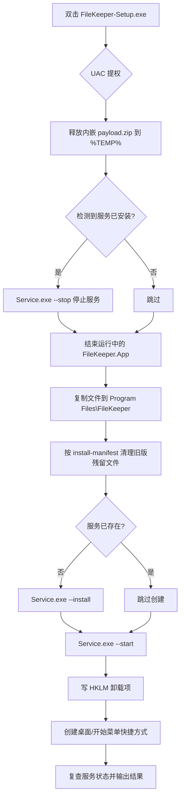

## 产品概述

给 FileKeeper 补一个可分发的安装程序：一个单独的 `FileKeeper-Setup.exe`，双击即可把程序安装到本机并立刻让后台服务跑起来，用户在系统「添加或删除程序」里可以干净地卸载掉。

## 核心功能

- **一键安装**：运行后自动安装到 `C:\Program Files\FileKeeper`（界面端在 `App` 子目录、后台服务在 `Service` 子目录），成功后 UAC 提权窗口只需确认一次
- **自动注册并启动服务**：安装完成后 `FileKeeperService` 已注册为自动启动服务，并且**已经开始运行**，用户不需要再去设置页手动点「安装服务」
- **创建快捷方式**：桌面与开始菜单各生成一个指向配置界面的快捷方式，带程序图标
- **干净的卸载**：从「添加或删除程序」卸载时，先停止并删除服务，再移除快捷方式、注册表项与程序文件，不会残留后台服务
- **覆盖安装**：再次运行安装包可直接升级，旧版本多余文件会被清理，用户的任务配置与日志默认保留
- **命令行模式**：支持 `/silent` 静默安装、`/uninstall` 卸载、`/purge` 卸载时一并清除数据目录，便于批量部署
- **不打扰用户**：安装完成后不自动弹出配置界面

## 边界与取舍

- 默认**保留** `%ProgramData%\FileKeeper`（任务配置与历史日志），卸载后仍留在本机；只有显式加 `/purge` 才会一并删除
- 卸载必须使用存放在安装目录内的同一个 `FileKeeper.Setup.exe /uninstall` 作为入口，避免卸载器丢失导致无法卸载

## 技术栈选择

- **语言/框架**：C# + .NET 8（`net8.0-windows`，控制台 `Exe`，用户已选定「纯 .NET 自研」方案）
- **压缩**：`System.IO.Compression.ZipFile`（BCL 自带）
- **注册表**：`Microsoft.Win32.Registry`（HKLM 卸载项）
- **快捷方式**：COM 后期绑定 `WScript.Shell`（`Type.GetTypeFromProgID` + `dynamic`），避免引入 COM 互操作程序集
- **安装包体积**：不依赖任何第三方工具与 NuGet 包，离线可构建（本机确认未安装 Inno Setup，也无 WiX）
- **与现有资产对齐**：复用 `FileKeeper.Service.exe` 已有的 `--install / --start / --stop / --uninstall` 四个入口，**不重复实现服务注册逻辑**

## 实现方案

### 整体策略：单个 exe + 内嵌 payload

已确认的关键事实决定了方案可以不改任何业务代码：

1. `src/FileKeeper.Service/Program.cs` 第 9–37 行已有自安装入口，内部调用 `ServiceControl.Install()`（`sc create ... start= auto` + `sc description` + `sc failure ... restart/5000/restart/10000/restart/30000`）并用 `Environment.ProcessPath` 作为 binPath。
2. `src/FileKeeper.App/Services/DialogService.cs` 的 `FindServiceExecutable()` 向上最多 6 层，每层依次尝试 `{dir}\FileKeeper.Service.exe` 与 `{dir}\Service\FileKeeper.Service.exe`。因此 **`{root}\App\FileKeeper.App.exe` + `{root}\Service\FileKeeper.Service.exe`** 的布局天然可被界面端找到，无需改动界面代码。
3. 已有图标 `src/FileKeeper.App/Assets/app.ico`。

因此安装器只需做四件事：**释放文件 → 写注册表 → 创建快捷方式 → 拉起 Service.exe 完成服务注册启动**。

### 关键技术决策与权衡

| 决策 | 选择 | 理由与代价 |
| --- | --- | --- |
| payload 承载 | `ZipFile` 打成 `payload.zip`，再以 `EmbeddedResource` 嵌入 Setup.exe | 单文件分发；dist 约 254 MB，`DEBUG` 无关 dll 可压缩到可接受体积。代价：需要「先 publish 再 build Setup」的两阶段流水线 |
| 是否引用 Core | **引用 `FileKeeper.Core`**，但只用 `ServiceControl.IsInstalled() / IsRunning() / GetStatusText()` 做状态复查 | 复用常量避免硬编码服务名。**严禁**调用 `ServiceControl.Install()`：它的 binPath 取 `Environment.ProcessPath`，在 Setup 进程里会把安装器本身注册成服务（正是界面端曾经踩过的坑），必须以子进程方式拉起 `Service.exe --install` |
| 进程位宽 | 显式 `win-x64` / `PlatformTarget x64` | 32 位进程写 HKLM 会被重定向到 `WOW6432Node`，导致「添加或删除程序」里看不到卸载项 |
| 提权 | 安装器 `app.manifest` 用 `requireAdministrator` | 写 Program Files、HKLM、注册服务都需要提权。这与 App 改为 `asInvoker` 的既定方案不冲突，App 仍保持不提权 |
| UI 形态 | 控制台输出进度，完成时用 `MessageBox`（user32 P/Invoke）给一个结果弹窗 | 不引入 WPF/WinForms，避免 App.csproj 那种 `<UseWindowsForms>` 破坏隐式全局 using 的麻烦；同时保留 stdout，便于静默模式取日志 |
| 占用处理 | 覆盖安装前先 `--stop` 服务、并结束正在运行的 `FileKeeper.App`；失败时提示用户手动关闭后再重试 | 服务 exe 与界面 exe 被占用会直接导致复制失败，这是覆盖安装最常见的失败点 |


### 安装流程（流程图）



### 卸载流程（用户选定）

通过 ARP 的 `UninstallString` 调用 `{app}\FileKeeper.Setup.exe /uninstall`：

1. 提权 → 2. `Service.exe --uninstall`（内部先 Stop 再 `sc delete`）→ 3. 删除快捷方式与开始菜单目录 → 4. 删除 HKLM 卸载项 → 5. 删除安装目录文件 → 6. 校验 `ServiceControl.IsInstalled() == false`
2. `%ProgramData%\FileKeeper` **默认保留**并在结束时提示路径；带 `/purge` 时才删除

## 实现注意事项（落地细节）

- **先 stop 再覆盖**：`Service\FileKeeper.Service.exe` 与 `App\FileKeeper.App.exe` 都会被进程占用，必须在复制前释放，否则 `IOException`。
- **旧文件残留**：每次安装后在 `{app}\install-manifest.txt` 写入本次释放的全部相对路径；升级时比对，删除「存在于 manifest 但不在本次 payload」中的文件，避免升级后遗留过期 dll。
- **状态复查优于退出码**：服务操作的结果一律以 `ServiceControl.IsInstalled() / IsRunning()` 复查为准（与现有 `DialogService.Run` 的既定做法一致），UAC 被取消、`sc` 部分失败都能体现出来。
- **临时文件**：payload 只能解压到 `Path.GetTempPath()` 下的独立目录，结束后递归删除；不能在源目录或 ProgramData 留中间产物。
- **不要 PublishSingleFile 掉 native 目录**：App 依赖 `native\7z.dll`、`native\7z.exe` 必须**释放到磁盘**才能被引擎加载，所以走 zip payload 方案（而非把依赖塞进单文件宿主），这一点在 `scripts/publish.ps1` 的既有自检里已有对应断言。
- **脚本编码**：`scripts/publish.ps1` 已是 UTF-8 with BOM（PowerShell 5.1 否则会把中文注释解析坏），修改时必须保留 BOM。
- **日志/输出**：stdout 逐行输出阶段与结果，静默模式下同样保留，便于排查。

## 架构设计


- 安装器**不重复实现**任何业务规则：服务注册/启停的全部语义仍由 `FileKeeper.Core.Services.ServiceControl` 通过 `FileKeeper.Service.exe` 的命令行入口提供，安装器只做编排与校验
- 项目扁平分层：`Program` 解析 CLI 并编排流程，其余按职责各一个类，避免把所有逻辑堆进 Main

## 目录结构

```
src/FileKeeper.Setup/                      # [NEW] 全部新增，安装器项目（不随产品日常运行）
├── FileKeeper.Setup.csproj                # net8.0-windows 控制台 Exe；引用 FileKeeper.Core；
│                                          #   ApplicationManifest=app.manifest（requireAdministrator）；
│                                          #   ApplicationIcon 指向 ../FileKeeper.App/Assets/app.ico；
│                                          #   PlatformTarget=x64 + RuntimeIdentifier=win-x64（避免注册表 32/64 重定向）；
│                                          #   EmbeddedResource 引用 $(MSBuildProjectDirectory)\payload\payload.zip
├── app.manifest                           # [NEW] requestedExecutionLevel level="requireAdministrator" uiAccess="false"
├── Program.cs                             # [NEW] CLI 入口：解析 install /uninstall /silent /purge /dir=；
│                                          #   串联安装或卸载流程，输出阶段进度，结束时 MessageBox 提示结果
├── InstallLayout.cs                       # [NEW] 安装布局常量与路径计算：安装根目录、
│                                          #   App 子目录、Service 子目录、Service.exe 路径、manifest 文件名；
│                                          #   布局需保证 App\Services\DialogService.FindServiceExecutable() 能命中
├── PayloadExtractor.cs                    # [NEW] 从嵌入资源取出 payload.zip → 解压到 %TEMP%\FileKeeperSetup_xxx；
│                                          #   返回解压目录并在 Dispose 时递归删除
├── FileInstaller.cs                       # [NEW] 复制到安装目录（含进度回调）；按 install-manifest.txt
│                                          #   删除上一版遗留文件；写入本次 manifest；结束后清理 %TEMP%
├── ServiceOrchestrator.cs                 # [NEW] 以子进程方式调用 Service.exe --install/--start/--stop/--uninstall，
│                                          #   并用 ServiceControl 复查真实状态；**禁止**直接调用 ServiceControl.Install()
├── ShortcutService.cs                     # [NEW] WScript.Shell COM 后期绑定创建/删除桌面与开始菜单快捷方式；
│                                          #   桌面对 CommonDesktopDirectory，开始菜单对 CommonStartMenu\Programs\FileKeeper
└── UninstallRegistry.cs                   # [NEW] 读写 HKLM\SOFTWARE\Microsoft\Windows\CurrentVersion\Uninstall\FileKeeper
                                           #   （DisplayName / DisplayVersion / Publisher / InstallLocation /
                                           #   DisplayIcon / UninstallString / EstimatedSize / NoModify / NoRepair）

现有文件（修改）
src/FileKeeper.sln                         # [MODIFY] dotnet sln add 加入 Setup 项目
scripts/publish.ps1                        # [MODIFY] 发布两步之后追加：生成 payload.zip（含 dist\App、dist\Service、app.ico）、
                                           #   发布 Setup 项目产出 dist\FileKeeper-Setup.exe、产物自检增加该 exe 存在性校验
README.md                                  # [MODIFY] 增加「安装包」章节：构建命令、双击安装行为、命令行参数、
                                           #   卸载入口与 ProgramData 保留策略
```

## 关键代码结构

```
// CLI 契约：安装器自身的能力边界，卸载通过 ARP 的 UninstallString 回调同一个 exe
public enum SetupAction { Install, Uninstall }

public sealed record SetupOptions(
    SetupAction Action,
    bool Silent,        // /silent：静默执行，不弹结果窗口，仅依赖 stdout 与退出码
    bool Purge,         // /purge：卸载时一并删除 %ProgramData%\FileKeeper
    string InstallRoot  // /dir=：自定义安装根目录，默认 C:\Program Files\FileKeeper
)
{
    public const string AppSubDirectory = "App";
    public const string ServiceSubDirectory = "Service";
    public const string InstallManifestFileName = "install-manifest.txt";
    public const string ServiceExecutableName = "FileKeeper.Service.exe";
}

// 安装编排：每一步都可单独失败并被上层记录，避免中途崩溃留下半成品
public interface ISetupFlow
{
    // 返回退出码：0 成功，非 0 失败
    Task&lt;int&gt; RunAsync(SetupOptions options, Action&lt;string&gt; report, bool throwOnError = true);
}
```

## Agent Extensions

### Skill

- **workflow-automator**
- Purpose：把「publish → 生成 payload.zip → 构建 Setup.exe → 产物自检」这条多步流水线编排进 `scripts/publish.ps1`，并处理 PowerShell 5.1 的 BOM 与错误码传递约定
- Expected outcome：一条命令产出 `dist\FileKeeper-Setup.exe`，失败时脚本立即以非 0 退出码中断并给出可读的失败阶段