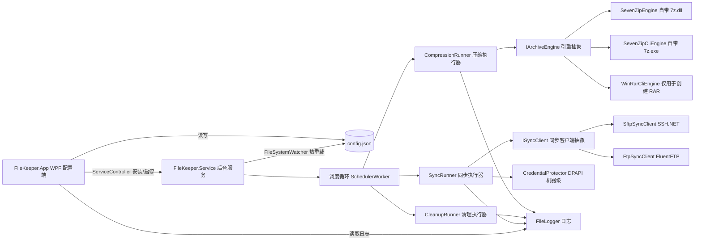

## 产品概述

FileKeeper —— 一个 Windows 桌面程序，用于「定时把指定目录的文件打包压缩」「定时清理过期文件」以及「定时把指定目录的文件上传到 SFTP / FTP 服务器」。程序以 Windows 服务形式随系统启动，在后台静默执行；通过一个 WPF 图形界面完成配置、手动执行、日志查看与服务管理。先交付可运行原型，再迭代完整功能与打包发布。

## 核心功能

1. **定时压缩任务**：选择源目录（可选是否含子目录、按扩展名过滤），设置输出存放目录与文件名模板，按「每天 / 每周（可选周几）/ 每月（可选几号）」加具体时刻自动执行；压缩格式为 ZIP（程序内置 7-Zip 引擎，默认可用）与 RAR（RAR 为商业格式，创建 RAR 需系统安装 WinRAR，界面会自动探测并在缺失时置灰提示）；支持压缩级别、可选密码、可选分卷、压缩成功后删除源文件。
2. **定时清理任务**：选择目录（可选递归），按「全部文件 / 指定扩展名」限定范围，按天/周/月输入阈值并统一换算为天数，超过该时长的文件自动永久删除；时间基准可选「最后修改时间」或「创建时间」；删除结果全部记入日志。
3. **定时同步任务（新增）**：把指定本地目录的文件按同样的「每天 / 每周 / 每月 + 具体时刻」调度**上传**到 SFTP 或 FTP 服务器。

- 协议：SFTP（SSH）；FTP 明文（21）；FTPS 显式（AUTH TLS）。不做 FTPS 隐式，不做双向镜像。
- 认证：SFTP 支持「用户名 + 密码」「私钥文件（PEM / OpenSSH）」「私钥 + 口令」；FTP/FTPS 使用用户名 + 密码。
- 策略：**增量同步**（按「文件大小 + 最后修改时间」比对，只传新增或已变更的文件）、**保留远程目录结构**（按本地相对路径在远程逐级建目录）、可选**上传成功后删除本地源文件**（归档模式）。
- 不做「删除远程多余文件」的镜像清理。

4. **随系统自动启动**：程序注册为 Windows 服务，开机即运行，无需登录交互；界面提供服务安装、卸载、启动、停止与状态显示。
5. **图形界面**：任务列表总览（启用状态、上次/下次运行时间）、压缩 / 清理 / 同步三类任务的编辑页、运行日志查看、设置页（服务管理、引擎可用性检测、连接测试）；支持关闭窗口最小化到系统托盘。
6. **分阶段交付**：原型阶段跑通「建任务 → 装服务 → 按调度真实压缩 / 删除 / 上传」全链路，随后完善界面与高级选项，最后产出发布包。

## 边界说明

- 删除为永久删除并记日志，不进回收站；本期不做空跑预览、不自动删除空目录。
- 同步仅支持**本地 → 远程**单向上传；不做远程 → 本地下载，不做双向镜像，不删除远程多余文件。
- 服务以 LocalSystem 运行，访问无凭据的网络共享目录（UNC）可能失败（已知限制，后续可支持指定运行账号）。
- SFTP 主机指纹校验：原型阶段默认自动接受并记录指纹到日志，界面提供「严格校验指纹」开关（后续）。
- 冒烟验证只使用临时目录与本地搭建的测试服务，不触碰真实业务数据。

## 技术栈选型

- **语言 / 框架**：C# 12 + .NET 8（`net8.0-windows`），UI 为 WPF，服务为 Worker Service 模板。
- **UI 库**：MVVM 采用 `CommunityToolkit.Mvvm`；托盘图标采用内置 `System.Windows.Forms.NotifyIcon`；样式为自研 Fluent 风格资源字典（不引入 HandyControl，避免框架兼容风险，同时完全掌控设计规范中的色板与字体）。
- **压缩引擎**：`Squid-Box.SevenZipSharp` + 随包自带的官方 `7z.dll` / `7z.exe`（7-Zip 26.05，LGPL 可再分发）；创建 RAR 回退到自动探测的 WinRAR `Rar.exe`。
- **同步引擎**：`SSH.NET`（SFTP）+ `FluentFTP`（FTP / FTPS 显式），两者均支持 net8.0 / netstandard2.0。
- **凭据保护**：`System.Security.Cryptography.ProtectedData`（DPAPI），**必须使用 `DataProtectionScope.LocalMachine`**。
- **配置与日志**：`System.Text.Json` 落盘 `config.json`；日志为自研轻量文件日志（按天分文件 + 保留策略）。
- **服务**：`Microsoft.Extensions.Hosting.WindowsServices`；安装 / 卸载通过 `sc.exe` / `ServiceController`，GUI 以 `requireAdministrator` 清单提权。
- **环境已核实**：`dotnet 8.0.425`；`Microsoft.WindowsDesktop.App 8.0.31` 运行时已装；本机已装 WinRAR（`C:\Program Files\WinRAR\Rar.exe`），未装 7-Zip（故 `7z.dll` / `7z.exe` 随包自带，已就位并通过实测）。

## 实现方案

采用「**WPF 配置端 + Windows 服务常驻执行端**」双进程架构：服务运行在 Session 0 无法显示界面，因此只负责调度与执行；WPF 只负责配置与展示。两端通过 `%ProgramData%\FileKeeper\config.json` 共享数据，服务用 `FileSystemWatcher` 监听配置变更并热重载，GUI 通过 `ServiceController` 控制服务启停。

**关键技术决策与权衡**：

1. **双引擎抽象 `IArchiveEngine`**：唯一能同时满足「内嵌 7z 库」与「支持 RAR」两条需求的方案。`SevenZipEngine`（默认，自带 7z.dll）负责 ZIP 创建 / 解压与 RAR 解压；`SevenZipCliEngine`（自带 7z.exe）在需要密码时使用（库后端的加密压缩不支持保留目录结构）；`WinRarCliEngine` 仅在创建 RAR 时启用。未探测到 WinRAR 时，UI 将 RAR 选项置灰并提示原因。
2. **凭据加密必须用 `DataProtectionScope.LocalMachine`（关键陷阱）**：GUI 以管理员用户运行、服务以 LocalSystem 运行，二者 DPAPI 上下文不同。若用默认的 `CurrentUser` 作用域，GUI 加密的密码服务将无法解密。**必须显式指定机器级作用域**，代价是本机任意用户可解密（风险可接受，因为该机器本就承载着服务）。写入 `config.json` 前加密，界面回显只显示占位符，日志绝不记录密码。
3. **同步客户端抽象 `ISyncClient`**：SFTP 与 FTP 的 API 差异很大，必须抽象为「连接 / 列举远端属性 / 建目录 / 上传（含临时文件 + 改名）/ 删除远端」，`SyncRunner` 只依赖抽象，从而让增量比对、重试、后处理删除源文件的逻辑只写一份。
4. **增量比对规则**：远端文件不存在、或大小不一致、或**本地最后修改时间比远端晚 2 秒以上**才上传。用「本地更晚」而不是「两者不等」，避免时钟误差与服务端时区差异导致每次都全量重传。
5. **上传原子性**：统一先传到 `<目标名>.filepart`，成功后再改名（SFTP 用 `RenameFile`，FTP 用 `Rename`），避免中断留下半截文件被误当作完整文件。
6. **自研轻量调度器而非 Quartz.NET**：需求频率模型固定（天/周/月 + 时刻），用 30 秒 tick + 纯函数 `NextRunUtc` 计算即可；`LastRunUtc` / `NextRunUtc` 持久化到 JSON，重启后可按「是否补跑」开关决定是否补执行错过任务。
7. **配置单一文件 + 原子写**：GUI 与服务可能同时访问，采用「写临时文件 → 原子替换 → 重试读取」，并给服务侧 `FileSystemWatcher` 加 500ms 去抖。

**性能与可靠性**：

- 文件枚举统一用 `EnumerationOptions`（`IgnoreInaccessible = true`、`AttributesToSkip = ReparsePoint`）避免权限异常与符号链接死循环；大目录采用 `Directory.EnumerateFiles` 惰性枚举。
- 压缩失败时文件被占用是主要风险：先尝试独占打开探测，被占用则跳过并记录，任务整体不中断，下次调度自然覆盖。
- 删除前二次校验路径（路径必须在任务目录之下、且排除系统目录与配置 / 日志目录），防止误删。
- 网络操作统一设置连接超时与读写超时，失败重试 3 次（指数退避），单个任务执行加 `CancellationToken`，服务停止时优雅退出。
- 同步任务**先建立连接并校验远端根目录可达**，再逐个比对上传，避免连不上时反复尝试每个文件。

## 架构设计



- **数据流转**：GUI 编辑任务 → 写入 `config.json` → 服务监听到变更重载 → 调度循环每 30 秒比对 `NextRunUtc` → 命中则执行对应执行器 → 结果写日志并回写 `LastRunUtc` / `NextRunUtc` → GUI 刷新显示。
- **分层**：`Core`（模型 / 配置 / 引擎 / 执行 / 调度计算 / 日志 / 安全）为共享内核；`Service` 与 `App` 为两个独立宿主，互不引用。

## 目录结构

工作区已有三个项目并已编译通过。本轮新增同步相关文件（标注 `[NEW-SYNC]`），其余为已完成或待办。

```
文件压缩和删除桌面程序/
├── FileKeeper.sln
├── README.md
├── .gitignore / .editorconfig
├── scripts/
│   ├── publish.ps1                         # 发布：产出 dist/App 与 dist/Service
│   └── smoke-test.ps1                      # 冒烟：临时目录验证压缩 / 删除 / 同步
└── src/
    ├── FileKeeper.Core/                    # 共享内核，net8.0（禁止引用 WPF 程序集）
    │   ├── Models/
    │   │   ├── Enums.cs                    # [MODIFY-SYNC] 增加 SyncProtocol、SftpAuthMode；TaskKind 增加 Sync
    │   │   ├── ScheduleConfig.cs           # [DONE]
    │   │   ├── CompressionTask.cs          # [DONE]
    │   │   ├── CleanupTask.cs              # [DONE]
    │   │   ├── SyncTask.cs                 # [NEW-SYNC] 同步任务：本地目录、协议、主机端口、远端目录、增量 / 保留结构 / 传后删源、超时
    │   │   ├── SyncCredential.cs           # [NEW-SYNC] 认证方式、密码、私钥路径、私钥口令（密文存储）
    │   │   ├── AppConfig.cs                # [MODIFY-SYNC] 根配置增加 List<SyncTask> SyncTasks
    │   │   └── TaskRunResult.cs            # [DONE]
    │   ├── Configuration/
    │   │   ├── AppPaths.cs                 # [DONE]
    │   │   └── ConfigStore.cs              # [DONE]
    │   ├── Security/
    │   │   └── CredentialProtector.cs      # [NEW-SYNC] DPAPI 加解密，强制 LocalMachine 作用域，跨进程可解
    │   ├── Engines/
    │   │   ├── IArchiveEngine.cs           # [DONE]
    │   │   ├── SevenZipEngine.cs           # [DONE]
    │   │   ├── SevenZipCliEngine.cs        # [DONE]
    │   │   ├── WinRarCliEngine.cs          # [DONE]
    │   │   ├── ExternalToolLocator.cs      # [DONE]
    │   │   ├── ArchiveEngineFactory.cs     # [DONE]
    │   │   ├── ISyncClient.cs              # [NEW-SYNC] 同步客户端抽象：连接、取远端属性、建目录、上传、删除
    │   │   ├── SftpSyncClient.cs           # [NEW-SYNC] SSH.NET 实现，支持密码与私钥（含口令）
    │   │   ├── FtpSyncClient.cs            # [NEW-SYNC] FluentFTP 实现，支持明文与 FTPS 显式，被动模式
    │   │   └── SyncClientFactory.cs        # [NEW-SYNC] 按协议创建客户端并校验凭据完整性
    │   ├── Scheduling/
    │   │   └── ScheduleCalculator.cs       # [TODO] 纯函数：由上次运行时间 / 当前时间计算 NextRunUtc（日/周/月）
    │   ├── Execution/
    │   │   ├── FileSelector.cs             # [TODO] 安全枚举：惰性枚举、扩展名过滤、排除目录
    │   │   ├── FileNameTemplate.cs         # [TODO] 文件名模板渲染与重名处理
    │   │   ├── CompressionRunner.cs        # [TODO] 压缩执行：选文件 → 调引擎 → 校验产物 → 可选删源
    │   │   ├── CleanupRunner.cs            # [TODO] 清理执行：按时间基准筛选 → 路径白名单 → 删除并计数
    │   │   ├── SyncRunner.cs               # [NEW-SYNC] 同步执行：连接 → 增量比对 → 原子上传 → 可选删源 → 重试
    │   │   └── TaskRunnerFactory.cs        # [TODO] 按任务类型分发（压缩 / 清理 / 同步）
    │   ├── Logging/                        # [DONE] IAppLogger.cs、FileLogger.cs
    │   ├── Runtime/
    │   │   └── ServiceControl.cs           # [TODO] 服务安装 / 卸载 / 启动 / 停止 / 状态查询
    │   └── Native/                         # [DONE] win-x64/7z.dll、7z.exe、NOTICE.txt
    ├── FileKeeper.Service/
    │   ├── Program.cs                      # [TODO] 宿主入口：UseWindowsService、日志、异常兜底
    │   ├── SchedulerWorker.cs              # [TODO] 调度循环：30 秒 tick、热重载、到期执行、串行化
    │   └── appsettings.json
    └── FileKeeper.App/
        ├── app.manifest                    # [DONE]
        ├── App.xaml(.cs)                   # [DONE→TODO] 入口、DI 容器、托盘、全局异常捕获
        ├── Themes/Styles.xaml              # [TODO] Fluent 风格资源
        ├── Views/
        │   ├── MainWindow.xaml(.cs)        # [TODO] 左侧导航 + 内容区 + 服务状态条
        │   ├── TasksView.xaml(.cs)         # [TODO] 任务总览（压缩 / 清理 / 同步三个分区）
        │   ├── CompressionTaskEditView     # [TODO]
        │   ├── CleanupTaskEditView         # [TODO]
        │   ├── SyncTaskEditView.xaml(.cs)  # [NEW-SYNC] 同步任务编辑：目录、协议、主机端口、认证、远端目录、策略
        │   ├── LogView.xaml(.cs)           # [TODO]
        │   └── SettingsView.xaml(.cs)      # [TODO]
        ├── ViewModels/
        │   ├── MainViewModel / TaskListViewModel / CompressionTaskEditViewModel / CleanupTaskEditViewModel
        │   ├── SyncTaskEditViewModel.cs    # [NEW-SYNC] 同步任务绑定、校验与「测试连接」
        │   └── LogViewModel / SettingsViewModel
        └── Services/                       # [TODO] DialogService、TrayIconService
```

## 关键代码结构

```
// 一、同步任务模型（两端共享）
public enum SyncProtocol { Sftp, Ftp, FtpsExplicit }
public enum SftpAuthMode { Password, PrivateKey }

public sealed class SyncCredential
{
    public SftpAuthMode AuthMode { get; set; } = SftpAuthMode.Password;
    public string? Password { get; set; }        // DPAPI 密文，仅 SFTP 密码模式与 FTP 使用
    public string? PrivateKeyPath { get; set; }  // PEM / OpenSSH 私钥文件路径
    public string? Passphrase { get; set; }      // DPAPI 密文，私钥口令
}

public sealed class SyncTask
{
    public Guid Id { get; set; }
    public string Name { get; set; }
    public bool Enabled { get; set; }
    public string LocalDirectory { get; set; }
    public bool IncludeSubDirectories { get; set; } = true;
    public FileFilterMode FilterMode { get; set; }
    public List<string> Extensions { get; set; } = new();
    public SyncProtocol Protocol { get; set; } = SyncProtocol.Sftp;
    public string Host { get; set; }
    public int Port { get; set; }                // SFTP 22 / FTP 21
    public string Username { get; set; }
    public SyncCredential Credential { get; set; } = new();
    public string RemoteDirectory { get; set; }  // 远端根路径，例如 /backup
    public bool IncrementalSync { get; set; } = true;
    public bool PreserveDirectoryStructure { get; set; } = true;
    public bool DeleteLocalAfterUpload { get; set; }
    public int TimeoutSeconds { get; set; } = 60;
    public int RetryCount { get; set; } = 3;
    public ScheduleConfig Schedule { get; set; } = new();
}

// 二、同步客户端抽象（一次编写比对逻辑，两种协议复用）
public interface ISyncClient : IDisposable
{
    SyncProtocol Protocol { get; }
    Task ConnectAsync(CancellationToken ct);
    Task<RemoteFileInfo?> GetFileInfoAsync(string remotePath, CancellationToken ct);
    Task EnsureDirectoryAsync(string remoteDirectory, CancellationToken ct);
    Task UploadAsync(string localPath, string remotePath, IProgress<double>? progress, CancellationToken ct);
}

public sealed record RemoteFileInfo(long Size, DateTime LastModified);

// 三、凭据保护：必须是机器级，否则服务（LocalSystem）解不开界面（管理员用户）加密的密码
public static class CredentialProtector
{
    public static string? Protect(string? plain);
    public static string? Unprotect(string? cipher);
    // 内部固定使用 DataProtectionScope.LocalMachine
}
```

## 设计风格

采用 Fluent Design 风格（微软桌面软件设计语言）：柔和渐变、亚克力半透明、清晰层级、圆角卡片与轻阴影，契合 Windows 11 桌面客户端观感，配色克制、信息密度适中，偏工具类生产力软件。

## 页面规划（共 4 个主页面 + 3 个编辑抽屉）

### 1. 任务总览（主页面）

顶部导航条（程序名称、服务状态徽标、设置入口）；左侧导航（任务总览、运行日志、设置）；任务卡片区分**压缩任务 / 清理任务 / 同步任务**三段展示，每张卡片含任务名、源目录或目标主机、频率与下次运行时间、上次执行结果；操作区支持新增三类任务、启用 / 禁用、立即执行、编辑、删除；底部状态栏显示任务总数、下次最近执行时间、日志目录入口。

### 2. 压缩任务编辑页

基础区块（名称、源目录、是否含子目录、文件过滤）；输出区块（存放目录、文件名模板与实时预览、格式单选，RAR 未检测到 WinRAR 时置灰）；调度区块（天 / 周 / 月分段控件 + 时间选择器）；高级区块（压缩级别、密码、分卷、压缩后删源）；底部保存 / 立即试运行 / 取消。

### 3. 清理任务编辑页

目标区块（目录、递归、文件类型、排除目录）；规则区块（天 / 周 / 月阈值，实时显示等价天数，时间基准单选）；预警区块（橙色提示条说明永久删除不可恢复，并展示预计影响的文件样例）；调度与操作区块。

### 4. 同步任务编辑页（新增）

- **本地区块**：本地目录（浏览按钮）、是否含子目录、文件过滤（全部 / 指定扩展名标签输入）。
- **服务器区块**：协议单选（SFTP / FTP / FTPS 显式，切换协议时端口自动填入 22 或 21）、主机、端口、用户名。
- **认证区块**：随协议与认证方式动态切换 —— 密码输入框；或私钥文件路径（浏览按钮）+ 可选私钥口令。密码框统一显示为占位圆点，保存后界面只显示「已设置」。
- **远端区块**：远端根目录（如 `/backup`），带「测试连接」按钮（即时验证连通性与目录可达性，不落盘）。
- **策略区块**：增量同步开关（默认开）、保留远程目录结构开关（默认开）、上传成功后删除本地源文件开关（红色危险提示）。
- **高级区块（可折叠）**：超时秒数、失败重试次数。
- **底部操作条**：保存、立即同步、取消，保存时内联校验（主机非空、端口范围、私钥文件存在、本地目录存在）。

### 5. 运行日志页

筛选条（日期、任务、关键字、自动刷新）；日志列表（时间、级别彩色标签、任务名、消息）；统计条（成功 / 失败条目数、同步上传文件数与字节数）；操作区（打开日志文件夹、清空、导出）。

### 6. 设置页

服务区块（安装 / 卸载 / 启动 / 停止、状态卡片、随系统自动启动说明、未提权提示）；引擎区块（内嵌 7-Zip 库状态、7z.exe 路径、WinRAR 探测结果与 RAR 能力标识）；通用区块（日志保留天数、关闭最小化到托盘）；底部信息（版本号、配置与日志目录）。

### 7. 系统托盘

托盘图标常驻，双击打开主界面；右键菜单「打开主界面 / 立即执行全部任务 / 退出」；服务状态变更与同步失败时弹出气泡提示。

## 交互与动效

页面切换 200ms 淡入 + 轻微位移；卡片悬停上浮 2px 并加深阴影；开关与按钮 150ms 过渡；任务执行中显示进度环与可取消按钮；危险操作（删除源文件、永久删除、卸载服务、同步后删源）统一二次确认弹窗。

## 响应式

最小窗口 1100 x 700；窄宽度下左侧导航折叠为图标条，任务卡片由三列降为两列、单列；编辑页字段由两栏降为单栏堆叠。

## 进度与任务清单

- [x] `init-solution` 解决方案与三个项目骨架、NuGet 引用、`.gitignore`、`.editorconfig`
- [x] `core-models` 模型、`AppPaths`、`ConfigStore` 原子读写、`FileLogger` 按天日志
- [x] `core-engines` 双引擎（内嵌 7z.dll / 7z.exe / WinRAR）与工厂，已实测通过
- [ ] `core-execution` `ScheduleCalculator` 纯函数、`FileSelector` 安全枚举、`FileNameTemplate`、`CompressionRunner`、`CleanupRunner`
- [ ] `sync-engine` 同步数据模型与凭据保护（DPAPI 机器级）、`ISyncClient` 抽象、`SftpSyncClient`、`FtpSyncClient`、工厂
- [ ] `sync-runner` `SyncRunner` 增量比对、原子上传（临时文件 + 改名）、重试、上传后删源
- [ ] `service-worker` `SchedulerWorker` 调度循环（含同步任务分发）、配置热重载、`ServiceControl` 安装卸载启停
- [ ] `wpf-ui` 界面：主窗口导航、任务总览（含同步分区）、三类任务编辑页（含连接测试）、日志页、设置页、托盘
- [ ] `smoke-publish` 冒烟脚本（压缩 / 删除 / 同步，同步用本地搭建的测试服务验证）与发布脚本、README

## 验证要求

- 每个阶段结束必须 `dotnet build` 零错误零警告。
- 压缩 / 删除 / 同步三条链路必须在临时目录真实跑通后再进入下一阶段。
- 同步冒烟：本地启用一个临时 FTP / SFTP 服务端（或用内存级测试替身）验证「首次全量上传 → 二次执行跳过未变更文件 → 修改后重新上传 → 传后删源」。