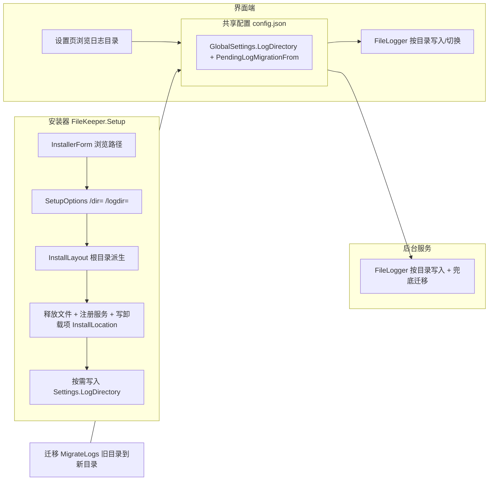

## 产品概述

让 FileKeeper 的安装位置与日志存放位置都可由用户决定：安装过程弹出简洁窗口，可浏览并选择安装目录与初始日志目录；装完后在界面端「设置」页随时改日志目录，切换时自动把历史日志搬过去。

## 核心功能

- 安装时手动选择安装路径：启动安装包弹出窗口，显示默认目录 `Program Files\FileKeeper` 并提供「浏览」按钮；静默部署仍可用 `/dir="路径"` 指定
- 安装时可一并指定初始日志目录（留空则用 `%ProgramData%\FileKeeper\logs`）
- 界面端「设置 → 通用」新增「日志目录」：文本框手动填写 + 「浏览」按钮选择，保存后界面端与后台服务同时生效
- 更换日志目录后自动迁移：把旧目录的 `.log` 文件搬到新目录，日志页仍能看到迁移前的历史日期与内容
- 卸载时从卸载项的 `InstallLocation` 反查真实安装目录，保证装到任意目录后都能干净卸掉

## 边界

- 安装器仍需管理员权限（提权后由 GUI 承载），`/silent` 下不弹任何窗口
- 配置文件本身仍固定存放在 `%ProgramData%\FileKeeper\config.json`，本次只让「日志」位置可变
- 不动 Core/Setup 之外已修好的坑：载荷 zip 正斜杠、安装包 UTF-8 输出、子进程 OEM 解码

## 技术栈

沿用现有：`.NET 8`（`net8.0-windows`）解决方案，WPF + CommunityToolkit.Mvvm 界面端、Worker Service 后台服务、控制台安装器，**零第三方依赖**。

- 安装器 GUI 选 **WinForms**（`<UseWindowsForms>true</UseWindowsForms>`）：`FolderBrowserDialog` 是本产品已在用的方案（`DialogService.BrowseFolder` 注释即写明「WPF 没有对应文件夹对话框」），运行时增量远小于 WPF，符合零依赖原则
- 安装器 `Main` 需加 `[STAThread]`：`FolderBrowserDialog` 必须有 STA 线程；`/silent` 或已通过 `/dir=` 指定路径时不创建窗体、不启动消息泵

## 实现方案

### 1. Core：日志目录成为可配置项

- `Models/AppConfig.cs` 的 `GlobalSettings` 增加两个字段：
- `LogDirectory`（可为 null，null 即使用默认 `%ProgramData%\FileKeeper\logs`）
- `PendingLogMigrationFrom`（待搬迁的旧目录，迁移成功后由代码清空）
- `Normalize()` 中对路径做 `Trim().Trim('"').TrimEnd('\\')` 处理，沿用 `DefaultOutputDirectory` 既有写法
- 新增 `FileKeeper.Core/Logging/LogPaths.cs`：`Resolve(string? configured)` 单一出口（空则退回 `AppPaths.LogsDirectory`），避免「各调用点各自判断」分散逻辑
- `FileLogger` 补齐/收敛目录参数：
- `GetAvailableDates()` 增加可选的 `logsDirectory` 重载（当前写死读默认目录，日志页因此看不到迁移后的目录）
- `WriteFatal` 增加可选 `logsDirectory` 参数（当前静态兜底写死默认目录）
- `ReadByDate` / `PurgeOldLogs` 已有目录参数，保持不变
- 新增实例方法 `Retarget(string newDirectory)`：关掉当前写句柄后切到新目录，让界面端热重载后不必重启即可写新位置
- 新增静态 `MigrateLogs(string from, string to)`：逐个 `File.Move` `.log` 文件，目标已存在则跳过、单文件失败不影响其余，返回搬迁数量
- 迁移触发与幂等：App 与 Service 是两份进程、共享同一份配置，都可能看到标记。做法：**谁先搬完谁负责清空标记**（通过 `ConfigStore.Update` 落盘），搬迁本身按文件逐个移动 + 跳过已存在项，天然幂等，不会两边同时搬丢文件

### 2. 安装器：可选路径 + 卸载反查

- `src/FileKeeper.Setup/FileKeeper.Setup.csproj`：加 `UseWindowsForms`（注意 App 项目曾用私有对话表明开启它会替换隐式全局 using，Setup 需按同样方式处理）
- 新增 `InstallerForm.cs`（代码构建的简洁窗体）：安装路径文本框 + 「浏览」按钮 + 日志目录文本框 + 「浏览」按钮 + 「安装 / 取消」，默认回填 `DefaultInstallRoot`，日志目录留空表示用默认值
- `SetupOptions` 恢复 `InstallDir` 并新增 `LogDir`，重建 `/dir=` 解析并加 `/logdir=`
- **卸载路径定位改为三级回退**（这是自定义路径后卸载正确的关键）：卸载项 `InstallLocation`（`UninstallRegistry` 一直在写，只是没人读）→ 安装包自身所在目录 → `DefaultInstallRoot`
- 安装并在配置指定日志目录时：通过 Core 的 `ConfigStore` 写入 `%ProgramData%\FileKeeper\config.json` 的 `Settings.LogDirectory`（未提供则不动配置）
- `InstallLayout` 的派生路径逻辑（App/Service 子目录两层级，服务宿主上溯可命中）**不需要改动**，本次反转只是把之前删掉的「根可传入」恢复

### 3. 界面端：设置页可改日志目录

- `App.xaml.cs`：构造 `FileLogger` 时传入解析后的日志目录（当前是无参默认目录），并订阅配置变更 → 目录变化时先迁移再 `Retarget`
- `ViewModels/SettingsViewModel.cs`：新增 `LogDirectory` 属性、`BrowseLogDirectory` 命令（**复用现有 `IDialogService.BrowseFolder`**），保存走既有 `_config.Update` 写入 `GlobalSettings`；显示层要明确「留空 = 使用默认目录」
- `Views/SettingsPage.xaml`：在「通用」卡片增加日志目录一行（文本框 + 浏览按钮），实现时需先读该文件确认现有行布局与绑定写法，保持同款样式
- `ViewModels/LogViewModel.cs`：把 `GetAvailableDates()` / 读取调用改为传入当前生效日志目录，否则改了目录界面仍读旧位置

### 4. 后台服务：按同一份配置写日志

- `src/FileKeeper.Service/Program.cs`：`AddSingleton<IAppLogger>` 处改为按配置解析日志目录；启动流程增加一次迁移尝试（服务以 LocalSystem 运行，对 `%ProgramData%` 的写权限比非提权界面端更可靠，因此它是迁移的兜底执行者）

### 5. 文档与流水线

- `README.md`：恢复 `/dir=` 并补 `/logdir=` 说明，写清「卸载依据卸载项的 InstallLocation 定位」与「改日志目录会自动搬迁历史日志」
- 验证仍走 `scripts/publish.ps1`（已有的阶段化流水线，无需改动）

## 实现注意

- **卸载必须改**：这是本次最容易漏的一环，装到 `D:\xxx` 后若仍取默认根目录，会出现「卸载了错目录」或「目录删不掉」
- **/silent 不能因 STA/窗体卡住**：GUI 只在未提供 `/dir=` 且非静默时创建
- **权限失败要有归宿**：界面端（非提权）搬迁旧 `ProgramData` 日志可能无权；失败时保留 `PendingLogMigrationFrom` 标记交由服务侧重试，不要吞掉也不要误判迁移完成
- **COD 一致性**：日志目录的「唯一解析出口」放在 Core，避免 App/Service/安装器各自拼路径再次产生今天这种不一致
- 全解决方案保持 `0 警告 / 0 错误`

## 架构结构



## 目录结构

```
src/
├── FileKeeper.Core/
│   ├── Models/AppConfig.cs                # [MODIFY] GlobalSettings 增加 LogDirectory、PendingLogMigrationFrom 及其 Normalize 处理
│   ├── Configuration/AppPaths.cs          # [MODIFY] 让默认日志目录可被 Core 侧统一解析，注释说明「配置优先、默认兜底」
│   └── Logging/
│       ├── LogPaths.cs                    # [NEW] Resolve(configured) 单一解析出口
│       └── FileLogger.cs                  # [MODIFY] GetAvailableDates/WriteFatal 支持目录参数；新增 Retarget 与静态 MigrateLogs
├── FileKeeper.Setup/
│   ├── FileKeeper.Setup.csproj            # [MODIFY] 增加 UseWindowsForms
│   ├── Program.cs                         # [MODIFY] [STAThread]、恢复安装目录参数、新增日志目录参数、卸载三级回退定位、按需写配置、按 GUI 结果执行
│   ├── InstallerForm.cs                   # [NEW] 安装路径与日志目录选择窗体（文本框 + 浏览按钮 + 安装/取消）
│   └── UninstallRegistry.cs               # [MODIFY] 新增读取 InstallLocation 的方法供卸载定位
├── FileKeeper.App/
│   ├── App.xaml.cs                        # [MODIFY] FileLogger 按配置目录构造，配置变更时迁移并切换
│   ├── ViewModels/SettingsViewModel.cs    # [MODIFY] 日志目录属性、浏览命令、保存逻辑
│   ├── ViewModels/LogViewModel.cs         # [MODIFY] 日期列表与日志读取改用当前生效目录
│   └── Views/SettingsPage.xaml            # [MODIFY] 通用卡片增加日志目录输入行与浏览按钮
├── FileKeeper.Service/
│   └── Program.cs                         # [MODIFY] 日志按配置目录，启动时兜底执行迁移
└── README.md                              # [MODIFY] 安装/卸载参数与日志目录说明同步
```

## 设计风格

沿用界面端已有的 Fluent 深色语言：深紫罗兰主色 + 玻璃层次卡片 + 圆角控件，安装窗体与界面端视觉保持同一家人，避免「安装器像别的软件」。

## 安装窗体（InstallerForm）

顶部标题区「安装 FileKeeper 文件守护」+ 副标题说明写入 Program Files 与注册服务；中部两张卡片分别承载安装目录与日志目录，每张卡片为「标签 + 文本框 + 浏览按钮」，日志目录卡片副文案写明「留空则使用 %ProgramData%\FileKeeper\logs」；底部右侧「安装」主按钮与「取消」次按钮，焦点默认落在安装按钮，支持 Enter/Esc。文本框路径不可写时给出行内红色提示而不是事后弹窗。

## 界面端设置页新增行

在「通用」卡片末尾追加一行「日志目录」：左侧标签与说明文案（留空表示默认目录），中部文本框，右侧「浏览」次按钮（复用现有 BrowseFolder 对话框，初值取当前生效目录），与既有的「日志保留天数」等行保持完全一致的间距、圆角与强调色。